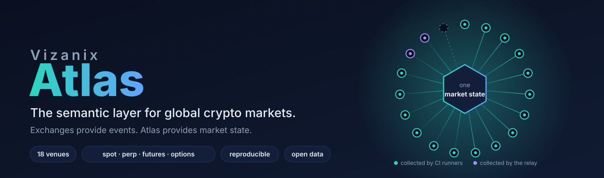
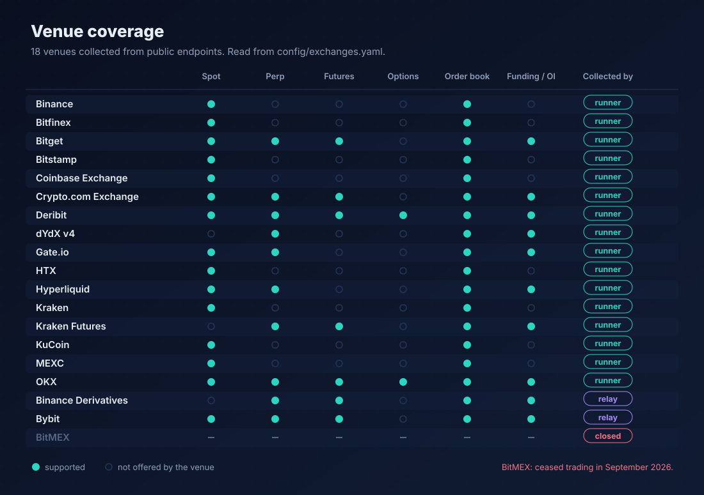
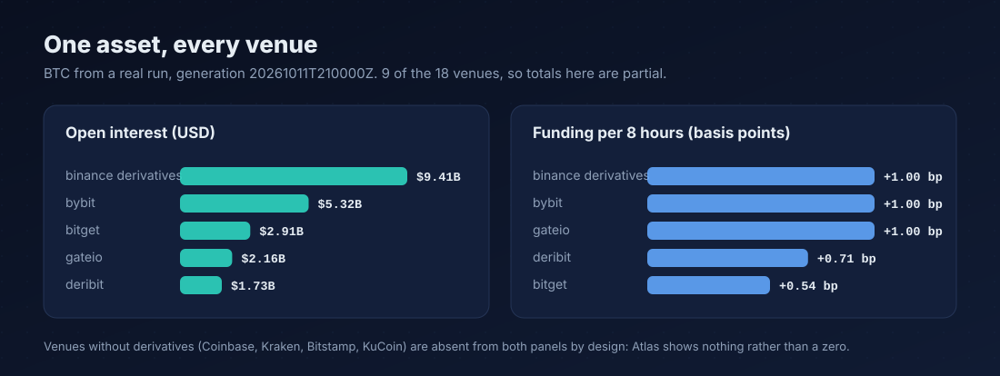
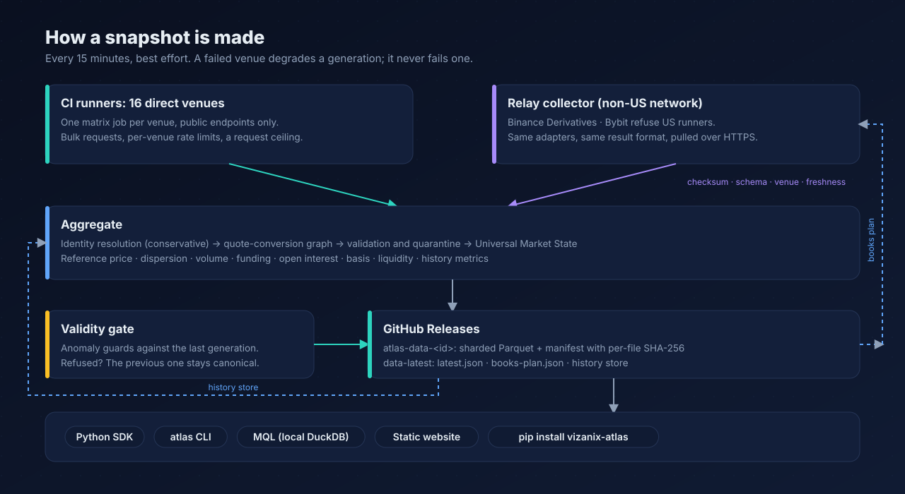

<div align="center">



<br>

[](https://github.com/Vizanix-Team/Atlas/actions/workflows/ci.yml)
[](https://github.com/Vizanix-Team/Atlas/actions/workflows/security.yml)
[](LICENSE)
[](pyproject.toml)
[](#what-works-today)
[](https://vizanix.tech)

**One reproducible market-state object per asset, across 18 venues, with coverage, quality and provenance shown next to every number.**

[Quick start](#quick-start) · [Venue coverage](#venue-coverage) · [How it works](#how-it-works) · [Query language](#market-query-language) · [Status](#what-works-today) · [Docs](#documentation)

</div>

---

Crypto trades on hundreds of venues that disagree about symbols, quote currencies, contract sizes, funding intervals and what "24h volume" means. Atlas turns those fragmented public observations into **one typed market state per asset**: a robust cross-venue reference price, dispersion, reported volume, funding, open interest, basis and liquidity, each with the venues behind it, the ones left out and why.

```python
from vizanix_atlas import Atlas

atlas = Atlas.latest()                   # downloads, caches and checksum-verifies the newest generation

btc = atlas.asset("BTC")
btc.reference_price                      # capped, volume-weighted robust median, not one exchange's last trade
btc.venue_count                          # venues that contributed
btc.state().volume                       # reported volume; spot and derivatives kept apart
btc.state().open_interest                # contracts converted with each venue's own contract size
btc.raw()                                # every published field for the asset
```

> **Exchanges provide events. Atlas provides market state.**

## What you get

| | |
|---|---|
| **Universal Asset Graph** | One canonical asset across venues. Identity resolution is deliberately conservative: two tokens sharing a ticker stay apart unless evidence (contract address, chain, curated override) says they are one. |
| **Universal Market State** | One typed object per asset: reference price, dispersion, volume, funding (normalised to 8 h), open interest, basis, liquidity, coverage, quality and provenance. |
| **Honest quote currencies** | USDT, USDC and USD are never assumed equal. Conversions come from observed rates, and a USD figure is left empty when no conversion is observable. |
| **Explainable numbers** | Every venue row shows its price, weight, deviation and, if excluded, the reason. |
| **Reproducible and verifiable** | Sharded Parquet, a manifest with per-file SHA-256, a validity gate, and last-known-good publication. Nothing is back-filled or interpolated. |
| **Market Query Language** | A small, safe language that runs locally over the downloaded Parquet. No server, no API key. |
| **GitHub-native** | Collection, aggregation, publication and the website run on GitHub Actions, Releases and Pages. |

## Install

```bash
pip install vizanix-atlas
```

This installs the `atlas` command (also available as `vizanix-atlas`) and the `vizanix_atlas` package. Python 3.11 or newer, no Docker, no credentials.

> The name `atlas` on PyPI belongs to an unrelated project, which is why the package is `vizanix-atlas`. Until the first PyPI release is published, install straight from the repository: `pip install "git+https://github.com/Vizanix-Team/Atlas"`.

From source, with the test suite:

```bash
git clone https://github.com/Vizanix-Team/Atlas && cd Atlas
python -m venv .venv && source .venv/bin/activate
pip install -e ".[dev]"
pytest
```

## Quick start

Read the latest published generation:

```bash
atlas status
atlas asset BTC
atlas market --top 15
atlas query "SELECT asset, venue_count FROM market ORDER BY venue_count DESC LIMIT 10"
```

Or run the pipeline yourself. This is the same code path the scheduled workflow runs:

```bash
for v in okx coinbase kraken bitstamp bitget; do
  atlas collect --exchange $v --output .local-data/collected
done
atlas build-dataset --input .local-data/collected --output .local-data/dataset
atlas verify .local-data/dataset
atlas asset BTC --source .local-data/dataset
```

`build-dataset` refuses to publish from fewer than four successful venues, by design; see [quality](docs/QUALITY.md).

This is what `atlas asset BTC` prints from a real run (nine venues, so partial coverage is reported as such):

```text
BTC  Bitcoin
  asset_id            asset:native:bitcoin:BTC
  resolution_state    resolved
─────────────────────────────── Reference price ───────────────────────────────
  value               83352.89
  method              spot_weighted_median
  venue_count         8
─────────────────────────────────── Volume ────────────────────────────────────
  reported_24h_usd    12087349437.02131
───────────────────────────────── Derivatives ─────────────────────────────────
  funding_8h_median   5.394e-05
  open_interest_usd   21526266516.502148
  perp_basis_bps      17.620315684314825
────────────────────────────────── Liquidity ──────────────────────────────────
  best_spread_bps     0.0011996882981039736
  venue_count         3
─────────────────────────────────── Quality ───────────────────────────────────
  coverage_ratio      0.8888888888888888
  venue_count         8
  is_partial          True
```

## Venue coverage



- **Runners** collect 16 venues directly, on GitHub-hosted runners.
- **Relay** venues, Bybit and Binance derivatives, refuse United States addresses (HTTP 403 and 451), which is where GitHub-hosted runners run. Atlas does not disguise where it runs. They are collected with the same adapters from a network where they answer normally, and the workflow pulls the validated result over HTTPS: only `https`, a SHA-256 manifest, schema and venue checks, and a freshness limit. A stale result becomes an explicit `failed` record, never a silent gap. See [the relay](docs/RELAY.md).
- **BitMEX** is not a technical gap: the exchange ceased trading in September 2026 and has no live market. It stays listed, disabled, with the evidence recorded as test fixtures.
- Tokenised equities, ETFs, commodities and FX listed as contracts (Bybit `stock`/`ETF`/`commodity`/`forex`, Binance `TRADIFI_PERPETUAL`) are skipped: Atlas is a crypto market-state layer.
- Binance publishes open interest only per symbol, so Atlas samples its highest-volume contracts and leaves open interest empty for the rest, never zero.

## One asset, every venue



The venue decomposition is a published table, not a footnote: for every asset you can see each venue's price, weight, deviation from the reference, funding, open interest and depth.

## How it works



Failure is normal. One venue failing produces a *degraded* generation, not a failed one. A generation that fails the validity gate never replaces the last known good one. Two small pieces of state carry from one run to the next, and neither may fail a run:

- the **order-book plan** (tier B): after each published generation Atlas chooses, deterministically, which liquid markets get an order-book snapshot next time, and every collector fetches those books in the same pass as its tier A data;
- the **history store**: a compact Parquet of the most liquid assets' recent snapshots that feeds the windowed metrics. It is never overwritten from a failed read, never back-filled, and read strictly before the snapshot being built.

Details: [architecture](docs/ARCHITECTURE.md) · [GitHub design](docs/GITHUB_ARCHITECTURE.md) · [storage](docs/STORAGE.md) · [relay](docs/RELAY.md).

## Market Query Language

MQL compiles to parameterised DuckDB SQL and runs on your machine against downloaded Parquet. It is not SQL passthrough: no functions, joins, files or network.

```sql
SELECT asset, reference_price, venue_count, price_dispersion_bps, reported_volume_24h_usd
FROM market
WHERE venue_count >= 8 AND reported_volume_24h_usd > 10000000
ORDER BY price_dispersion_bps DESC
LIMIT 20;
```

```bash
atlas query "SELECT asset, venue_count FROM market ORDER BY venue_count DESC LIMIT 10"
```

Only metrics with data behind them are selectable ([MQL reference](docs/MQL.md)).

## CLI

`status` · `asset` · `search` · `market` · `query` · `exchanges` · `methodology` · `verify` · `collect` · `aggregate` · `build-dataset` · `publish-github` · `fetch-relay` · `relay-publish` · `compact-day` · `housekeeping` · `export-web`

Every read command accepts `--source` (a local path or generation ID) and most accept `--json`.

## What works today

| Capability | Status |
|---|---|
| 18 venue adapters (spot, perpetual, dated futures, options), tested against recorded live payloads | Working |
| Bybit and Binance USD-M / COIN-M, collected through the relay | Working (verified against the live APIs) |
| BitMEX | Closed by the venue; documented and disabled |
| Bulk instrument and ticker discovery in one short run per venue | Working |
| Conservative asset resolution, quote-conversion graph, validation and quarantine | Working |
| Reference price, dispersion, reported volume, funding (8 h-normalised), open interest, basis | Working, where venues supply inputs |
| Sharded Parquet dataset, manifest, checksums, validity gate, last-known-good publication | Working |
| Python SDK with lazy, checksum-verified downloads; `atlas` CLI; MQL | Working |
| Static website: assets, market, scanner, exchanges, methodology, dataset | Working |
| Order-book liquidity: depth bands, impact estimates (tier B) | Wired into the scheduled runs; the first books appear one generation after the first publish |
| History store and the windowed metrics that read it | Wired; accumulates from the first publish. Each metric appears once its minimum observations exist (for example 24 h volatility after 48 snapshots, the 30-day funding percentile after 720) |
| Market Genome, similarity search | Needs 28 days of history; empty until then, by design |
| Scheduled workflows: collect, daily compaction, housekeeping, Pages, CodeQL | Written and tested; first runs on the new organisation pending |
| Option surfaces, skew and term structure | Not yet |
| DEXs | Not supported |

Roadmap and the reasons behind each gap: [ROADMAP](docs/ROADMAP.md) · [LIMITATIONS](docs/LIMITATIONS.md).

## Data freshness and honesty

- Snapshots are **scheduled (every 15 minutes, best effort), not real time**. GitHub can delay or drop scheduled runs; delays and gaps are recorded, never filled.
- Volume is **reported by venues** and not independently verified.
- Public endpoints only. No private data, no accounts, no API keys. Atlas never uses a proxy or any other trick to reach a venue that has refused its network; relay venues are collected from a network where they answer normally, and that is stated everywhere it matters.
- Read [limitations](docs/LIMITATIONS.md) before relying on any number.

## Documentation

[Architecture](docs/ARCHITECTURE.md) · [Specification](docs/SPECIFICATION.md) · [Methodology](docs/METHODOLOGY.md) · [Metric dictionary](docs/METRICS.md) · [Market state](docs/MARKET_STATE.md) · [MQL](docs/MQL.md) · [Data model](docs/DATA_MODEL.md) · [Asset resolution](docs/ASSET_RESOLUTION.md) · [Quality](docs/QUALITY.md) · [Exchange adapters](docs/EXCHANGE_ADAPTERS.md) · [Data sources](docs/DATA_SOURCES.md) · [Relay](docs/RELAY.md) · [Data policy](docs/DATA_POLICY.md) · [Operations](docs/OPERATIONS.md) · [Releasing](docs/RELEASING.md) · [Benchmarks](docs/BENCHMARKS.md) · [Roadmap](docs/ROADMAP.md) · [Limitations](docs/LIMITATIONS.md)

## Contributing and security

Adding a venue, a metric or an identity mapping has a checklist: [CONTRIBUTING.md](CONTRIBUTING.md). Report vulnerabilities per [SECURITY.md](SECURITY.md). Community expectations: [CODE_OF_CONDUCT.md](CODE_OF_CONDUCT.md).

The graphics above are generated from the repository's own configuration and a recorded snapshot: `python scripts/render_readme_assets.py`.

## License

Code: [Apache-2.0](LICENSE). **A code license is not a data license.** Venue-derived data is governed by each venue's terms; see the [data policy](docs/DATA_POLICY.md).

## Disclaimer

Research and infrastructure tooling, not investment advice. [DISCLAIMER.md](DISCLAIMER.md).

---

<div align="center">

Maintained by [**Vizanix**](https://vizanix.tech), which builds algorithmic trading infrastructure: exchange integrations, execution and market-data systems, and quantitative tooling.

</div>
