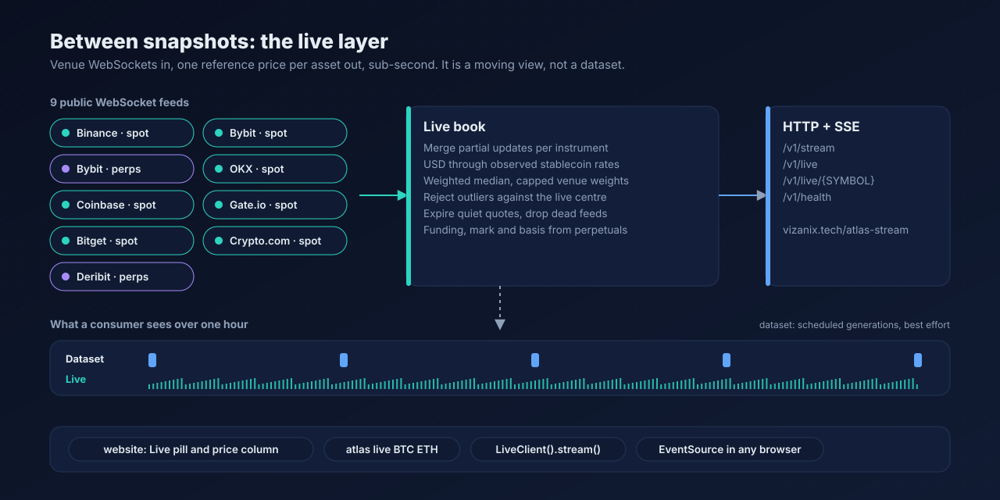

# The live layer

Datasets answer "what was the market state at 09:30?". They are versioned, reproducible and replayable, and by construction they arrive in slots: GitHub Actions can run a schedule every 15 minutes at best and, in practice, a low-traffic repository sees far fewer runs (the first scheduled runs after the publication fix came 3 to 7 hours apart). That is a property of the platform, not of the method.

The **live layer** answers a different question, "where is the market *now*?", and it does not depend on GitHub's scheduler at all. It holds public WebSocket connections to venues, merges every update into one reference price per asset as it arrives, and serves the result over HTTP and Server-Sent Events.



|  | Dataset | Live layer |
|---|---|---|
| Question | What was the state at slot *t*? | Where is the market now? |
| Freshness | A slot, best effort | Sub-second after a venue ticks |
| Reproducible | Yes (generation ID, checksums) | No. A moving view with no history |
| Coverage | All venues, all assets | The 150 most liquid assets of the latest generation, on 8 venues |
| Metrics | The full market state | Reference price, dispersion, venues, funding, open interest, basis |
| Where | GitHub Releases | `https://vizanix.tech/atlas-stream` (or your own) |

The live layer is **not** part of any published dataset and never writes to one.

## Using it

```bash
pip install vizanix-atlas
atlas live BTC ETH SOL          # a table that updates as prices move
```

```python
from vizanix_atlas.sdk.live import LiveClient

live = LiveClient()                       # https://vizanix.tech/atlas-stream, or $ATLAS_LIVE_URL
live.price("BTC")                         # one-shot reference price in USD
live.asset("BTC")                         # how each venue entered the price
for update in live.stream(["BTC", "ETH"]):  # blocks, reconnects on its own
    print(update["symbol"], update["price"], update["venues"])
```

`LiveClient` needs no dependency beyond the core ones. `astream()` is the asynchronous form. In a browser or any HTTP client:

```bash
curl -N "https://vizanix.tech/atlas-stream/v1/stream?assets=BTC,ETH"
```

### Endpoints

| Endpoint | Returns |
|---|---|
| `GET /v1/stream[?assets=BTC,ETH]` | Server-Sent Events. First a `snapshot` event with the current state, then `update` events with only the assets that changed |
| `GET /v1/live[?assets=BTC,ETH][&limit=N]` | The current live price of every followed asset |
| `GET /v1/live/{SYMBOL}` | One asset with every venue's contribution (weight, deviation, source, age, inclusion and reason) |
| `GET /v1/health` | Status of every feed: connected, messages, ticks, parse failures, reconnects, last error, age of the last frame |

A record:

```json
{
  "asset_id": "asset:native:bitcoin:BTC",
  "symbol": "BTC",
  "price": 83351.67,
  "venues": 7,
  "dispersion_bps": 0.3,
  "volume_24h_usd": 2926877088,
  "vs_generation_bps": -4.3,
  "identity": "resolved",
  "as_of": 1791805156849
}
```

`vs_generation_bps` is the move since the latest published generation, which is the honest way to show how stale the snapshot has become. `identity` is the generation's resolution state for the asset (`resolved` or `probable`).

## How the live price is made

The method is the dataset's ([METHODOLOGY](METHODOLOGY.md)), applied continuously:

1. **Merge.** Venues send partial updates (Bybit streams deltas). Each is merged into the latest state of that instrument; a missing field is kept, never zeroed.
2. **One candidate per venue**: its most liquid usable spot market, so a venue that lists BTC against USD and USDT is not counted twice.
3. **USD conversion** through the quote asset's own rate. USD is 1. A USD stablecoin is converted through the generation's observed rate and then through its *live* USD pair (for example USDT-USD), and only while that rate is within 500 bps of parity: a "rate" further out is more likely a broken market than a depeg worth pricing through. A quote currency that is not a USD stablecoin is not used.
4. **Outlier rejection** against the live centre. With at least three venues, one more than 300 bps from the weighted median is excluded with the reason `extreme_deviation`. With two venues nothing is rejected (no majority exists to define the market) and the dispersion figure shows the disagreement.
5. **Weights**: the square root of reported USD volume, scaled by freshness (linear to a floor over the staleness window) and by quote source (a live two-sided mid over a last trade), then **capped** so no venue exceeds the configured share. The numbers are the dataset's (`reference_price` in `config/collection.yaml`).
6. **Weighted median** of what remains, and a weighted MAD as dispersion.
7. **Expiry.** A quote nobody has updated for 5 minutes stops counting. A venue whose connection dropped stops counting after 20 seconds. An asset with no usable quote has **no live price** and is absent from the snapshot; the book never serves a stale number as live.

Perpetuals do not move the spot price. Bybit USDT perpetuals and Deribit inverse perpetuals add live funding (scaled to 8 hours), open interest and basis against the live reference price.

### Which assets and venues

The live layer reuses the identity mapping of the latest published generation, so a ticker two different tokens share cannot leak into a live price (see [ASSET_RESOLUTION](ASSET_RESOLUTION.md)). It follows the 150 most liquid assets that are `resolved`, or `probable` (the dataset already pools a probable asset across venues; set `universe.include_probable: false` to follow only firm identities), on at least two venues. The universe is rebuilt from the newest generation every 30 minutes; a change in the symbol set reconnects only the feeds it affects.

Feeds (all public, no credentials): Binance spot, Bybit spot and USDT perpetuals, OKX spot, Coinbase spot, Gate.io spot, Bitget spot, Crypto.com spot, Deribit inverse perpetuals. Each frame layout was recorded from the live endpoint and is pinned by tests. Venues without a usable public stream (Kraken's base symbols are unresolved in the dataset; KuCoin needs a token handshake; MEXC streams protobuf; HTX gzip) are not included yet.

## What it does not do

- **It is not for execution.** It is a reference estimate with network and aggregation latency and no SLA.
- **It does not republish venue data.** The per-asset detail explains how each venue entered the price (weight, deviation, source, age, exclusion reason) but does not pass on a venue's own price, volume or mark. See [DATA_POLICY](DATA_POLICY.md).
- **It is not history.** Nothing is stored. Use the dataset for anything that has to be reproduced.
- **It follows the generation's identities.** An asset the dataset leaves venue-scoped has no live price. Coverage of the long tail is bounded by identity resolution, which is conservative on purpose.

## Running your own

```bash
pip install "vizanix-atlas[stream]"     # adds the websockets dependency
atlas stream serve --host 127.0.0.1 --port 8787
```

Settings are in `config/stream.yaml` (universe size, expiry, deviation bound, emit interval, feed list, client limit). Put a reverse proxy in front for TLS. Server-Sent Events need response buffering off and a long read timeout:

```nginx
location ^~ /atlas-stream/ {
    proxy_pass http://127.0.0.1:8787/;
    proxy_http_version 1.1;
    proxy_set_header Connection "";
    proxy_buffering off;
    proxy_read_timeout 3600s;
    limit_except GET HEAD OPTIONS { deny all; }
}
```

The project's own instance runs as an unprivileged `systemd` unit (`NoNewPrivileges`, `ProtectSystem=strict`, a memory ceiling) with a one-minute health check that restarts it after two consecutive failed checks. See [OPERATIONS](OPERATIONS.md).

### Behaviour under failure

- One venue failing costs only that venue. Each connection has its own exponential back-off with jitter, reset only after it has held for 30 seconds. A venue that refuses this network (HTTP 403, 429 or 451) is retried every five minutes and reported as `refused_by_venue`; Atlas never disguises where it runs.
- A connection that goes silent for 90 seconds is closed and reopened.
- A frame that does not parse is counted (`parse_failures` in `/v1/health`) and dropped. That counter is the early warning for a venue changing its format.
- A slow client cannot hold the server hostage: each client keeps at most one pending record per asset, so a stalled reader receives the latest state instead of a backlog, and a write that blocks for 15 seconds closes the connection.
- The HTTP server bounds the request line (4 KiB), headers (16 KiB, 64 fields), read and write times, and total clients.

## Adding a feed

A feed is a class in `src/vizanix_atlas/stream/feeds.py` with three jobs: say how to subscribe, parse a frame into `LiveTick` values, and (if the venue wants one) name a keepalive. Everything else (reconnection, back-off, the idle watchdog, statistics, expiry) is shared.

1. Record real frames from the venue's public endpoint first, and put them in `tests/unit/test_stream_feeds.py` as the expected shapes. Do not write a parser from documentation alone.
2. Subclass `Feed`: set `venue` (a slug from `config/exchanges.yaml`), `instrument_class` (`spot`, `linear-perp` or `inverse-perp`, as in the dataset's `instruments` table), `name` and `url`; implement `subscribe_frames` and `parse`. The symbol a tick carries must equal the dataset's `symbol_native` for that instrument, which is how it finds its asset.
3. State volume in the unit the venue states it (`quote_volume_24h` or `base_volume_24h`), never converted: the book converts through the quote asset's USD rate.
4. Add the class to `FEEDS` and its name to `feeds:` in `config/stream.yaml`.
5. `parse` must not guess. Control frames (acknowledgements, pongs) return no ticks; a frame that is not valid for the venue raises (`json.loads` already does for non-JSON), and the runner counts the failure.
